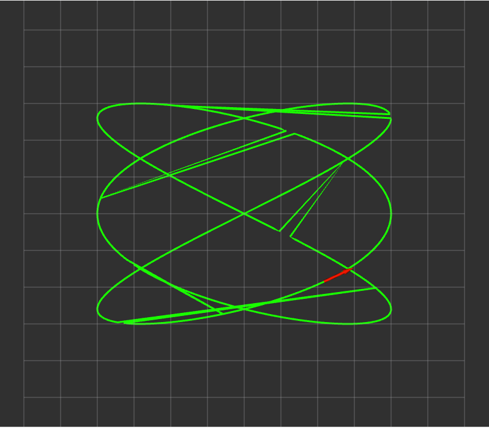
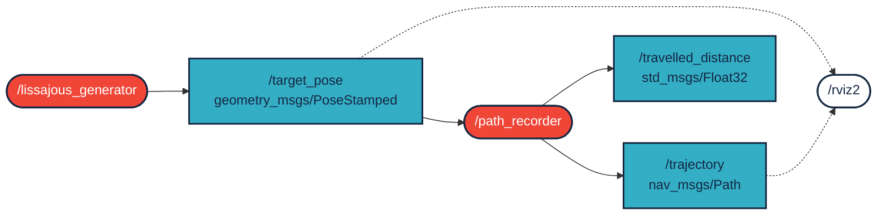

# `kov_gvv_pqrs` package
ROS 2 C++ package. [](https://docs.ros.org/en/humble/)

A package két node-ból áll. A `/lissajous_generator` node egy [Lissajous-görbén](https://hu.wikipedia.org/wiki/Lissajous-g%C3%B6rbe) mozgó célpontot szimulál, és annak pozícióját és haladási irányát `geometry_msgs/msg/PoseStamped` típusú üzenetként hirdeti a `/target_pose` topicban. A `/path_recorder` node feliratkozik erre a topicra, az utolsó *N* pózból `nav_msgs/msg/Path` típusú pályát épít, amit a `/trajectory` topicban hirdet (RViz2-ben megjeleníthető), valamint a megtett út hosszát `std_msgs/msg/Float32` típusként a `/travelled_distance` topicban. Megvalósítás `ROS 2 Humble` alatt.

<p align="center"></p>

A görbe egyenlete:

$$x(t) = A \cdot \sin(a \cdot t + \delta), \qquad y(t) = B \cdot \sin(b \cdot t)$$

A póz orientációja a görbe érintőjének irányába mutat: $\psi = \mathrm{atan2}(\dot{y}, \dot{x})$.

## Packages and build

It is assumed that the workspace is `~/ros2_ws/`.

### Clone the packages
``` r
cd ~/ros2_ws/src
```
``` r
git clone https://github.com/Armin-140/kov_gvv_pqrs
```

### Build ROS 2 packages
``` r
cd ~/ros2_ws
```
``` r
colcon build --packages-select kov_gvv_pqrs --symlink-install
```

<details>
<summary> Don't forget to source before ROS commands.</summary>

``` bash
source ~/ros2_ws/install/setup.bash
```
</details>

### Run

Mindkét node indítása launch fájllal:

``` r
ros2 launch kov_gvv_pqrs lissajous.launch.py
```

RViz2 vizualizációval együtt:

``` r
ros2 launch kov_gvv_pqrs lissajous.launch.py rviz:=true
```

Vagy a node-ok külön-külön, két terminálban:

``` r
ros2 run kov_gvv_pqrs lissajous_generator
```
``` r
ros2 run kov_gvv_pqrs path_recorder
```

### Ellenőrzés

``` r
ros2 topic echo /target_pose
```
``` r
ros2 topic echo /travelled_distance
```
``` r
ros2 topic hz /trajectory
```

## Node-ok és topicok



### `/lissajous_generator`

| Irány | Topic | Típus |
|---|---|---|
| publish | `/target_pose` | `geometry_msgs/msg/PoseStamped` |

| Paraméter | Alapérték | Leírás |
|---|---|---|
| `amplitude_x` | `4.0` | $A$, amplitúdó x irányban [m] |
| `amplitude_y` | `3.0` | $B$, amplitúdó y irányban [m] |
| `freq_a` | `3.0` | $a$, frekvencia x irányban |
| `freq_b` | `2.0` | $b$, frekvencia y irányban |
| `phase` | `π/2` | $\delta$, fáziseltolás [rad] |
| `speed` | `0.25` | időskálázás (mozgás sebessége) |
| `rate_hz` | `20.0` | publikálási frekvencia [Hz] |
| `frame_id` | `map` | a header `frame_id`-ja |

### `/path_recorder`

| Irány | Topic | Típus |
|---|---|---|
| subscribe | `/target_pose` | `geometry_msgs/msg/PoseStamped` |
| publish | `/trajectory` | `nav_msgs/msg/Path` |
| publish | `/travelled_distance` | `std_msgs/msg/Float32` |

| Paraméter | Alapérték | Leírás |
|---|---|---|
| `max_poses` | `500` | a pályában tárolt pózok maximális száma |

Paraméterek megadása induláskor, pl. más alakú görbéhez:

``` r
ros2 run kov_gvv_pqrs lissajous_generator --ros-args -p freq_a:=5.0 -p freq_b:=4.0
```
